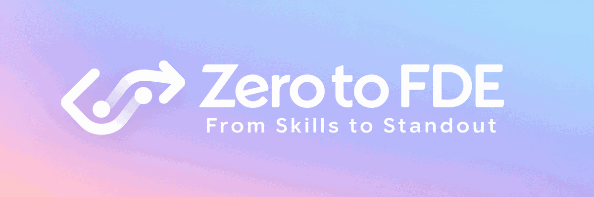
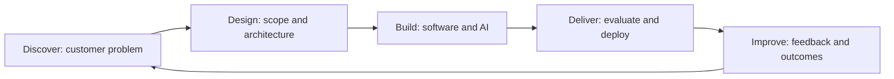

<div align="center">



# Zero to FDE

**From Skills to Standout.**

A free, practical, production-focused field guide to **Forward Deployed Engineering**.

Learn to turn ambiguous customer problems into working, tested, observable AI-enabled solutions — and build a portfolio that demonstrates how you deliver.

[](LICENSE)
[](curriculum/ROADMAP.md)
[](curriculum/README.md)
[](curriculum/09-capstone-projects/portfolio/)
[](https://github.com/AnkitParekh007/forward-deployed-engineering-from-scratch/actions/workflows/deploy-website.yml)

**[🚀 Start learning](https://ankitparekh007.github.io/forward-deployed-engineering-from-scratch/start/) · [🧭 Your FDE journey](https://ankitparekh007.github.io/forward-deployed-engineering-from-scratch/journey/) · [🛠️ Explore projects](https://ankitparekh007.github.io/forward-deployed-engineering-from-scratch/projects/)**

</div>

---

## 📖 What is Forward Deployed Engineering?

A Forward Deployed Engineer works at the intersection of engineering, product and customer outcomes. FDEs discover what customers actually need, make architectural decisions, build useful integrations and AI applications, deliver safely, and improve the solution as real-world evidence arrives.

Zero to FDE is an open-source learning path for that entire lifecycle — from understanding the problem to handing over a reliable solution.



## ✨ What you get

| | Learning experience |
|---|---|
| 📘 **21-day core** | 60 concise lessons across 12 phases; roughly 20 hours of lesson time |
| 🧭 **Personalized journey** | Five experience tracks, six evidence milestones and an interactive next-action recommendation |
| 🧠 **Professional depth** | 12 advanced modules covering architecture, retrieval, evaluations, integration, reliability and customer value |
| 🛠️ **Hands-on projects** | Seven customer-inspired briefs with synthetic data, runnable offline Python baselines and test plans |
| 🧪 **Practice and diagnostics** | Checkpoints, exercises, a ten-question skill diagnostic, field drills and interview practice |
| 📝 **Portfolio evidence** | Customer briefs, contracts, architecture decisions, evaluation results, runbooks and demos |
| 🌐 **Learning workspace** | Search, bookmarks, progress, recently viewed lessons, light/dark themes and responsive documentation |

The core is an introduction and a structured starting point, not a guaranteed job or a certification. Allow additional time for coding, debugging, independent projects and deliberate practice.

## 🎯 Choose your starting point

| Your background | Where to begin | Focus |
|---|---|---|
| 🌱 New to coding | Foundations explorer | Terminal, Git, programming and small working applications |
| 💻 Early-career developer | Early-career builder | Tested software delivery and integrations |
| 🤝 Analyst, consultant or solutions engineer | Customer-facing transitioner | Software fluency, data and evaluated AI |
| ⚙️ Experienced engineer | Senior engineering accelerator | Discovery, architecture, deployment and trade-offs |
| 🏗️ Staff, principal or architect | Principal / field architect | Cross-customer architecture, trust and operational ownership |

Not sure where to begin? Take the free [skill diagnostic](https://ankitparekh007.github.io/forward-deployed-engineering-from-scratch/journey/diagnostic/) and then choose your [experience track](https://ankitparekh007.github.io/forward-deployed-engineering-from-scratch/journey/).

## 🗺️ Curriculum roadmap

| Phase | Topic | What you will practice |
|:---:|---|---|
| 01 | [FDE mindset](curriculum/00-orientation/README.md) | Outcomes, customer context and field briefs |
| 02 | [Engineering foundations](curriculum/01-foundations/README.md) | Git, Python, TypeScript, data and HTTP |
| 03 | [Building and shipping software](curriculum/02-software-engineering/README.md) | UI, APIs, persistence, tests and CI |
| 04 | [Customer discovery](curriculum/03-customer-discovery/README.md) | Interviews, requirements, workflows and pilot metrics |
| 05 | [AI solution design](curriculum/04-ai-engineering/01-solution-design/README.md) | Model choices, scoping and rapid prototyping |
| 06 | [Data and integrations](curriculum/05-data-and-integrations/README.md) | Data quality, SQL, REST, webhooks and ETL |
| 07 | [LLM applications](curriculum/04-ai-engineering/02-llm-applications/README.md) | Context, structured outputs, embeddings, RAG and evaluation |
| 08 | [Agents and automation](curriculum/04-ai-engineering/03-agents/README.md) | Tool contracts, MCP, bounded workflows and reliability |
| 09 | [Deployment and observability](curriculum/06-deployment-and-observability/README.md) | Docker, environments, telemetry and incident response |
| 10 | [Security and responsible AI](curriculum/07-security-and-compliance/README.md) | Privacy, permissions, secrets and release review |
| 11 | [Customer delivery](curriculum/08-product-and-communication/README.md) | Demos, feedback, cost, ROI and handoff |
| 12 | [Capstone](curriculum/09-capstone-projects/README.md) | Build, evaluate and present an integrated customer solution |

📅 [Full day-by-day roadmap](curriculum/ROADMAP.md) · 📚 [Read the curriculum on GitHub](curriculum/README.md) · 🎓 [Professional learning path](curriculum/PROFESSIONAL_PATH.md)

### 🏁 Build evidence, not just completion percentages

| Milestone | Portfolio artifact |
|---|---|
| Understand and build | Field brief and reproducible working program |
| Ship a useful slice | Customer brief, tested prototype and baseline |
| Design around data | Data mapping, quality report and architecture decision |
| Build grounded AI | Grounded assistant, evaluation cases and human oversight |
| Make delivery dependable | Deployment diagram, trace sample, runbook and release checklist |
| Deliver and defend outcomes | Demo, case study, measured evidence and retrospective |

Use the [professional modules](https://ankitparekh007.github.io/forward-deployed-engineering-from-scratch/journey/pro/) to deepen skills, then bring them into a project. Progress is self-reported; no completion badge substitutes for evidence.

## 🛠️ Build your FDE portfolio

Seven synthetic customer engagements move you from a small prototype to a full pilot. Each project includes a customer brief, success criteria, architecture, build instructions, validation, demo guidance and a runnable baseline.

| Project | Customer problem | Skills demonstrated |
|---|---|---|
| 🎫 [Customer Issue Triage Assistant](curriculum/09-capstone-projects/portfolio/customer-issue-triage-assistant/README.md) | Route support tickets | Classification, evaluation |
| 📚 [Internal Knowledge Assistant](curriculum/09-capstone-projects/portfolio/internal-knowledge-assistant/README.md) | Answer policy questions | Retrieval, grounding |
| 📋 [Customer Onboarding Automation](curriculum/09-capstone-projects/portfolio/customer-onboarding-automation/README.md) | Turn briefs into checklists | Structured extraction, review |
| 🔗 [CRM and Workflow Integrator](curriculum/09-capstone-projects/portfolio/crm-and-workflow-integrator/README.md) | Synchronize customer events | APIs, idempotency |
| 📊 [AI-Powered Product Feedback Analyzer](curriculum/09-capstone-projects/portfolio/ai-powered-product-feedback-analyzer/README.md) | Organize customer feedback | Themes, evidence, insights |
| 🔍 [Production Incident Copilot](curriculum/09-capstone-projects/portfolio/production-incident-copilot/README.md) | Summarize alerts and impact | Observability, factual summaries |
| 🚀 [End-to-End Customer Solution](curriculum/09-capstone-projects/portfolio/end-to-end-customer-solution/README.md) | Deliver an integrated pilot | Architecture, evaluation, access and handoff |

**Start building immediately** — Python 3.10+ is enough for the offline starters. No paid model API or customer credentials are required.

```bash
git clone https://github.com/AnkitParekh007/forward-deployed-engineering-from-scratch.git
cd forward-deployed-engineering-from-scratch
python3 curriculum/09-capstone-projects/portfolio/customer-issue-triage-assistant/code/demo.py
```

The starter is a deterministic baseline, not a production AI service. Extend it, test it with independent synthetic fixtures, and document what works and what does not.

[Explore interactive projects](https://ankitparekh007.github.io/forward-deployed-engineering-from-scratch/projects/) · [Practice field scenarios](https://ankitparekh007.github.io/forward-deployed-engineering-from-scratch/journey/field-lab/) · [Prepare for interviews](https://ankitparekh007.github.io/forward-deployed-engineering-from-scratch/practice/interview-preparation/) · [Career preparation guide](curriculum/10-career-preparation/README.md)

## ⚙️ Technology stack

| Area | Technologies and concepts |
|---|---|
| Learning platform | React 19, TypeScript, Vite, Markdown, prerendered HTML |
| Engineering curriculum | Python, TypeScript, Git, HTTP/REST, SQL, PostgreSQL |
| Applied AI | Provider-neutral LLM patterns, context engineering, embeddings, RAG, MCP and evaluations |
| Production delivery | Docker, GitHub Actions, OpenTelemetry, reliability and privacy |
| Quality | Vitest, Playwright, automated accessibility checks and Lighthouse |
| Hosting | GitHub Pages; no backend or account required for the learning site |

## 💻 Developer quick start

**Prerequisites:** Node.js 22+, Python 3.10+, Git.

If you have not cloned the repository yet:

```bash
git clone https://github.com/AnkitParekh007/forward-deployed-engineering-from-scratch.git
cd forward-deployed-engineering-from-scratch
```

Start the learning platform:

```bash
cd website
npm ci
npm run dev
```

Open the development URL printed by Vite, using the configured base path `/forward-deployed-engineering-from-scratch/`.

### 🔧 Verify changes

From the repository root, regenerate authored content and run the offline labs before modifying the website:

```bash
python3 curriculum/build_curriculum.py
python3 curriculum/build_projects.py
python3 curriculum/assets/starter.py
python3 curriculum/assets/field_lab.py
python3 curriculum/assets/pro_lab.py

cd website
npm ci
npm test
npm run build
python3 scripts/verify-static.py
npx playwright install chromium
npm run test:e2e
```

See the [website development guide](website/README.md) and [validation workflow](.github/workflows/redesign-validation.yml) for the full checks and release process. On Linux CI, install browser system dependencies with `npx playwright install --with-deps chromium`.

## 🗂️ Repository structure

```text
forward-deployed-engineering-from-scratch/
├── curriculum/              # Markdown lessons, exercises, quizzes and projects
│   ├── 00-orientation/      # Start with the FDE mindset
│   ├── 01-foundations/     # Engineering foundations
│   ├── 02-software-engineering/
│   ├── 03-customer-discovery/
│   ├── 04-ai-engineering/
│   ├── 05-data-and-integrations/
│   ├── 06-deployment-and-observability/
│   ├── 07-security-and-compliance/
│   ├── 08-product-and-communication/
│   ├── 09-capstone-projects/
│   │   └── portfolio/       # Seven project briefs and runnable starters
│   ├── 10-career-preparation/
│   ├── assets/              # Synthetic labs and examples
│   ├── ROADMAP.md
│   └── PROFESSIONAL_PATH.md
├── website/                 # React + TypeScript learning platform
│   ├── src/
│   ├── scripts/
│   ├── tests/
│   └── public/
├── .github/workflows/       # Validation and GitHub Pages deployment
├── README.md
├── CONTRIBUTING.md
├── CODE_OF_CONDUCT.md
└── LICENSE
```

The editorial Python generators produce the consistent Markdown and catalog files. If you change generated curriculum content, update its source and regenerate it rather than editing generated output only.

## 🌐 Deployment and privacy

The [live platform](https://ankitparekh007.github.io/forward-deployed-engineering-from-scratch/) is deployed on GitHub Pages. The deployment workflow runs on pushes to `main`, validates the curriculum, builds the website and publishes only `website/dist`. For a fork, configure **Settings → Pages → Source → GitHub Actions** and adapt the base path and canonical URL if needed.

Your progress, bookmarks, theme, recent lessons and feedback remain in browser-local storage. The offline project examples use synthetic data. Never enter sensitive customer information or commit API keys.

## 🤝 Help build Zero to FDE

This guide is designed to grow with the community. You do not need to be an FDE already to contribute.

| You can help with | A good first contribution |
|---|---|
| 🐛 Bug fixes | Reproduce a broken lesson link or accessibility issue |
| 📝 Documentation | Clarify a prerequisite, improve an explanation or verify a reference |
| 💻 Code | Improve a runnable starter, add a synthetic test or fix a UI issue |
| 🧪 Learning design | Propose a realistic customer scenario or evidence checkpoint |
| 🎨 Experience | Improve responsive layout, keyboard access or reading flow |

1. [Open or browse issues](https://github.com/AnkitParekh007/forward-deployed-engineering-from-scratch/issues) and describe the learner problem.
2. Fork the repository and create a focused branch.
3. Make your change, run the relevant checks and submit a pull request.
4. Include what changed, why it matters and how reviewers can verify it.

Read the [contribution guide](CONTRIBUTING.md) and [code of conduct](CODE_OF_CONDUCT.md). Keep contributions original, accessible, reproducible and using synthetic data.

## 📚 References and license

Zero to FDE is independently authored. The [professional path](curriculum/PROFESSIONAL_PATH.md) credits external curriculum inspiration; third-party references retain their original terms. The [resource library](https://ankitparekh007.github.io/forward-deployed-engineering-from-scratch/resources/) links to official tools and documentation.

Licensed under the [MIT License](LICENSE). Created and maintained by [Ankit Parekh](https://github.com/AnkitParekh007).

---

<div align="center">

**Learn in public. Build with evidence. Deliver with confidence.**

If this guide helps you, consider [starring the repository](https://github.com/AnkitParekh007/forward-deployed-engineering-from-scratch), sharing it with another engineer, or contributing a practical improvement.

[Start learning →](https://ankitparekh007.github.io/forward-deployed-engineering-from-scratch/start/)

</div>
