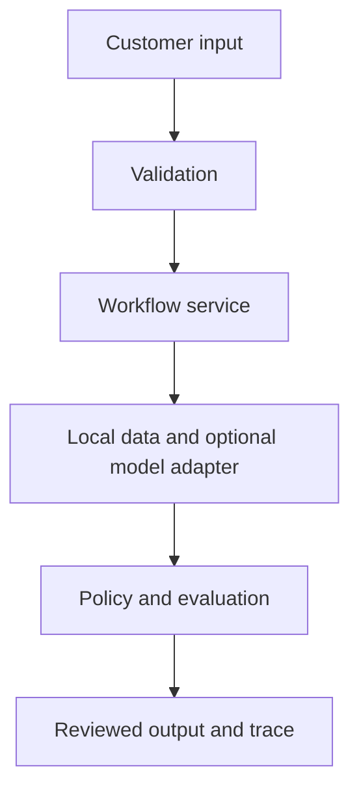

# Customer Onboarding Automation

## Customer brief
The fictional Implementation manager requests a pilot. Use synthetic data only.

## Problem statement
Convert a customer brief into a reviewable checklist.

## Success metrics
capture at least 8 of 10 expected requirements. This is a target, not a measured result.

## Technical requirements
- Input: customer brief.
- Output: draft checklist, missing fields and review state.
- Local reproducible baseline, validated input, no committed secrets.
- Optional model adapter runs only in a trusted backend.

## Architecture

## Step-by-step build guide
1. Create ten labeled synthetic examples, including malformed and empty cases.
2. Implement the baseline: extract labeled requirements and create a checklist requiring human approval.
3. Add a local CLI or UI, structured errors, and record correlation IDs.
4. Run the test plan and record observed metrics, latency and limitations.
5. Add optional model support only after the baseline passes.

## Test plan
Check omitted requirements and reject invalid approval transitions. Record results and denominator.

## Deployment
Run and test locally. Publish the static demo on GitHub Pages; keep API credentials and privileged operations on a trusted backend if you add one. Document how to restore the last known-good release.

## Demo script
Introduce the customer problem; run a valid example, demonstrate an error or abstention, show evaluation evidence, and explain next steps.

## Retrospective
- What did the baseline fail to handle?
- Which assumption needs customer validation?
- What would block a real rollout?

## Portfolio description
Designed and implemented a simulated customer onboarding automation pilot, including evaluation and documented limitations. Add measured results only after completing the tests.
