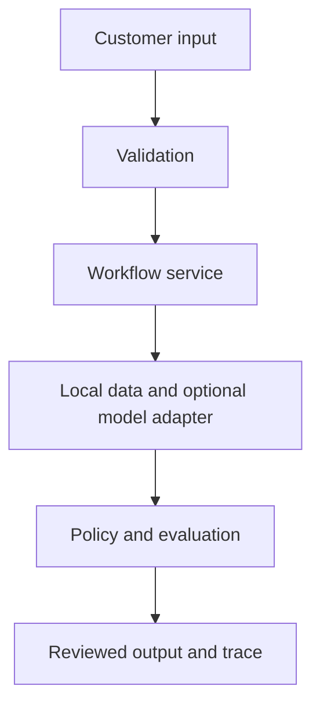

# Production Incident Copilot

## Customer brief
The fictional Service owner requests a pilot. Use synthetic data only.

## Problem statement
Summarize synthetic alerts and draft a status update.

## Success metrics
all supplied impact facts cited and no invented root cause. This is a target, not a measured result.

## Technical requirements
- Input: synthetic timestamped log events.
- Output: timeline, impact and suggested next check.
- Local reproducible baseline, validated input, no committed secrets.
- Optional model adapter runs only in a trusted backend.

## Architecture

## Step-by-step build guide
1. Create ten labeled synthetic examples, including malformed and empty cases.
2. Implement the baseline: sort events, summarize known facts, mark unknowns and require review.
3. Add a local CLI or UI, structured errors, and record correlation IDs.
4. Run the test plan and record observed metrics, latency and limitations.
5. Add optional model support only after the baseline passes.

## Test plan
Test missing events and check that uncertain claims remain labeled. Record results and denominator.

## Deployment
Run and test locally. Publish the static demo on GitHub Pages; keep API credentials and privileged operations on a trusted backend if you add one. Document how to restore the last known-good release.

## Demo script
Introduce the customer problem; run a valid example, demonstrate an error or abstention, show evaluation evidence, and explain next steps.

## Retrospective
- What did the baseline fail to handle?
- Which assumption needs customer validation?
- What would block a real rollout?

## Portfolio description
Designed and implemented a simulated production incident copilot pilot, including evaluation and documented limitations. Add measured results only after completing the tests.
